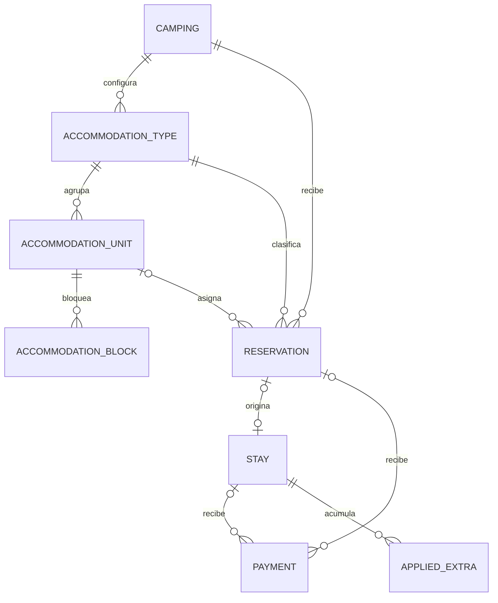

# Reservas de Maytu: arquitectura y etapas

## Alcance acordado

Backend y contratos; la UI se diseña por separado. Una reserva corresponde a una cabaña, habitación completa o grupo de camping libre. No hay ítems de reserva, camas individuales ni agrupaciones de reservas en esta entrega.

- Inventario `individual`: una unidad concreta por reserva, disponible durante todo el rango.
- Inventario `unlimited`: camping libre sin unidad ni límite de cupos; registrar llegada prevista y anticipos no garantiza capacidad cuantificada.
- Un camping mantiene su moneda y zona horaria; la sesión determina el camping autorizado.
- No agregar roles, organizaciones, procesadores de pago ni conectividad OTA.

## Relaciones

Todas las entidades nuevas se aíslan por camping. Las claves compuestas validan pertenencia además de los controles de autorización de servicios futuros. No existe un catálogo de huéspedes compartido entre campings.

Una reserva guarda responsable y contacto, fechas locales, ocupantes, origen neutral, notas, estado y snapshot del precio acordado. El tipo define modalidad, ocupación máxima y tarifa base; la unidad identifica el espacio físico. Los bloqueos describen unidad, rango y motivo, sin huésped ni cobros.

## Ciclo de vida y disponibilidad

Pendiente → confirmada → ingresada → finalizada. Pendiente y confirmada pueden pasar a cancelada o no presentado. El ingreso exige confirmación y produce como máximo una estadía, idempotentemente. No se reabren estados terminales en esta entrega.

Pendientes y confirmadas consumen inventario. No hay vencimiento automático ni liberación por ausencia del huésped. Cancelación y no presentado liberan inventario explícitamente. Las reservas ingresadas conservan su asignación hasta la salida acordada; presencia real y disponibilidad prevista se muestran como conceptos distintos.

Fechas PostgreSQL `date`, formato ISO, intervalo `[checkInDate, checkOutDate)` con salida posterior a entrada. Una salida permite otra entrada ese día. No reutilizar el cálculo de cobro mínimo de una noche del piloto para determinar solapamientos.

Cada escritura que afecte inventario bloqueará la fila del camping dentro de una transacción. Luego validará unidades, reservas y bloqueos, y persistirá el cambio, la auditoría y el outbox juntos. Todas las rutas de escritura deben respetar ese protocolo. Las ediciones validarán el reemplazo excluyendo la reserva anterior dentro de la misma transacción. La consulta mensual leerá rangos y agregará por noche, sin N consultas por fecha. Además de cupos nocturnos, devolverá unidades disponibles para todo el rango.

Una estadía abierta que supera su salida prevista requiere resolución: no impide guardar reservas futuras, pero sí ingresar otro grupo a su unidad. Extender la reserva vuelve a validar disponibilidad; nunca desplaza silenciosamente otra reserva.

## Precios, pagos y transición

Espacios cerrados: tarifa por unidad/noche y total acordado editable explícitamente. Camping libre: tarifa por persona/noche conservando rangos infantiles del piloto. El snapshot guarda la base de cálculo y el importe acordado; cambiar configuración no altera reservas existentes. Modificaciones de fechas o alojamiento requieren aceptar un nuevo presupuesto.

Cada reserva admite múltiples pagos en efectivo, transferencia o tarjeta. El pago recibido es un único registro: al ingresar se vincula también a su estadía, sin copiarlo. Los pagos históricos conservan su `stay_id`. Los saldos se derivan del precio y pagos no anulados; no son campos editables.

Anular un anticipo erróneo conserva motivo, actor y fecha y lo excluye del saldo. Cancelar una reserva no anula sus pagos. Las devoluciones quedan fuera de alcance; un anticipo retenido sigue visible y pendiente de resolución fuera del sistema.

El piloto anterior no tiene usuarios activos: no se exige compatibilidad con sus contratos ni una activación gradual por camping. Se reutiliza la lógica útil de estadías, extras y pagos, pero puede adaptarse al modelo nuevo sin capas de compatibilidad. No inferir unidades desde ubicaciones libres ni fabricar cobros. Los ingresos directos a unidades cerradas también deberán validar inventario. Cualquier reinicio de datos se hará de forma explícita; esta implementación no borra bases del piloto.

## Etapas y validación

1. **Fundación:** modelos Zod, componentes OpenAPI, Swagger para rutas actuales, entidades y migraciones. No publicar rutas futuras como operativas. Validar consistencia y pertenencia entre campings.
2. **Inventario:** API `/api/accommodations/types`, `/api/accommodations/units`, `/api/accommodations/blocks` y `/api/availability`; disponibilidad estricta, bloqueos y concurrencia PostgreSQL.
3. **Reservas y anticipos:** API `/api/reservations`, comandos de ciclo de vida, precios congelados, pagos y anulaciones, idempotencia, versiones, auditoría y outbox atómicos.
4. **Estadías:** ingreso desde reserva, asociación de pagos, cierre y resolución de permanencias. Adaptar los contratos existentes cuando convenga; no mantener contratos paralelos por compatibilidad.
5. **Integraciones futuras:** interfaces neutrales, mapeos e importación idempotente, sin proveedores conectados. Guardar reservas externas confirmadas con conflicto para resolución explícita; nunca descartarlas. Documentar revisiones atrasadas, reintentos y prevención de bucles.

Cada etapa requiere pruebas y revisión antes de la siguiente. El despliegue es separado. Las migraciones nuevas no se aplican automáticamente al iniciar la API.

Pruebas prioritarias: solapamientos, entradas/salidas contiguas, disponibilidad continua de una unidad, operaciones simultáneas, cambios y cancelaciones, bloqueos, zona horaria y horario de verano de Chile, aislamiento por camping, idempotencia, anulaciones, precios históricos y rollback de reserva/pago/auditoría/outbox. Usar PostgreSQL real y exclusivamente una base identificada como test.

## OpenAPI y cliente futuro

Los modelos Zod son la fuente de validación y tipos y se convierten a componentes OpenAPI. Documentar reglas de negocio que JSON Schema no pueda representar, además de verificarlas en servicios. Las entidades TypeORM representan persistencia, no DTO públicos.

El documento de rutas debe describir solo endpoints implementados, con request/response, errores, parámetros, seguridad por cookie y `operationId` estable. Exportación offline sin conectar a PostgreSQL. Swagger se habilita explícitamente en producción. La futura UI generará su cliente RTK Query desde OpenAPI; no se genera ni modifica cliente en esta etapa.
