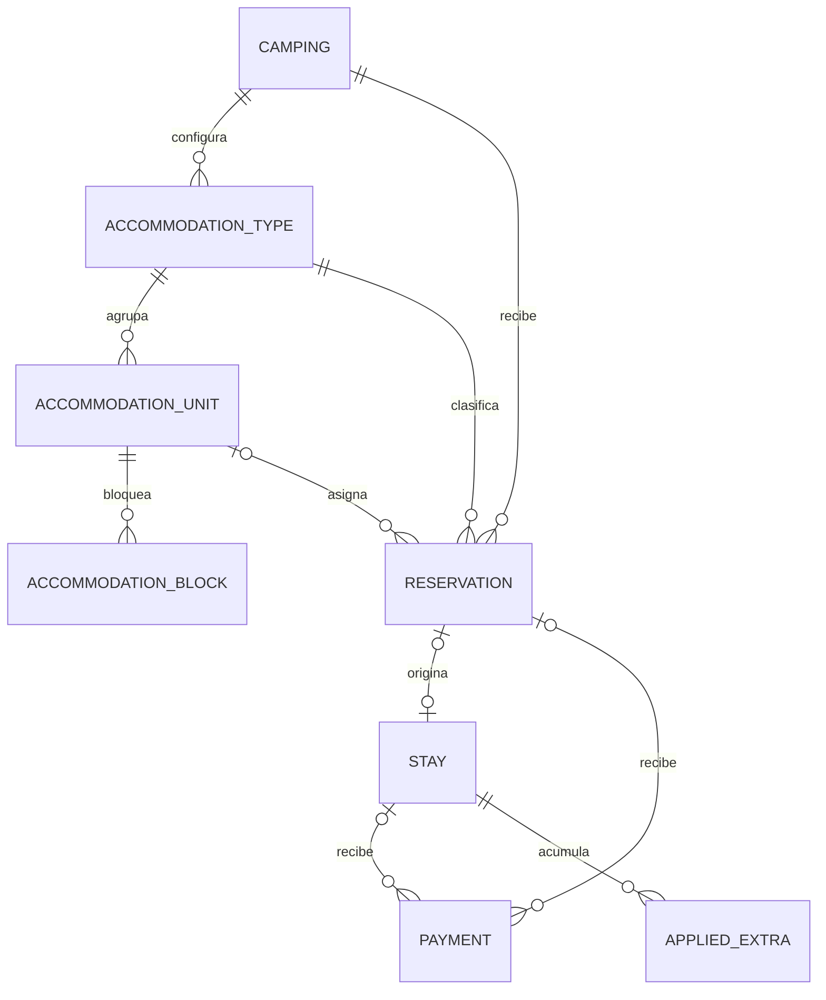

# Reservas de Maytu: arquitectura y etapas

## Alcance acordado

Backend y contratos; la UI se diseña por separado. Una reserva corresponde a una cabaña, habitación completa o grupo de camping. No hay ítems de reserva, camas individuales ni agrupaciones de reservas en esta entrega.

- Inventario `individual`: una unidad concreta por reserva, disponible durante todo el rango.
- Inventario `unlimited`: camping sin unidad ni límite de cupos; registrar llegada prevista y anticipos no garantiza capacidad cuantificada.
- Un camping mantiene su moneda y zona horaria; la sesión determina el camping autorizado.
- No agregar roles, organizaciones, procesadores de pago ni conectividad OTA.

## Relaciones

Todas las entidades nuevas se aíslan por camping. Las claves compuestas validan pertenencia además de los controles de autorización de servicios futuros. No existe un catálogo de huéspedes compartido entre campings.

Una reserva guarda responsable y contacto, fechas locales, ocupantes, canal de
reserva (`source`), notas, estado y snapshot del precio acordado. `source` es
un texto de canal para la reserva y se normaliza a `manual` cuando se omite;
no representa el origen técnico de una mutación. El tipo define modalidad,
ocupación máxima y tarifa base; la unidad identifica el espacio físico. Los
bloqueos describen unidad, rango y motivo, sin huésped ni cobros.

## Ciclo de vida y disponibilidad

Pendiente → confirmada → ingresada → finalizada. Pendiente y confirmada pueden pasar a cancelada o no presentado. El ingreso exige confirmación y produce como máximo una estadía, idempotentemente. No se reabren estados terminales en esta entrega.

Pendientes y confirmadas consumen inventario. No hay vencimiento automático ni liberación por ausencia del huésped. Cancelación y no presentado liberan inventario explícitamente. Las reservas ingresadas conservan su asignación hasta la salida acordada; presencia real y disponibilidad prevista se muestran como conceptos distintos. Una estadía física abierta también bloquea su unidad aunque la salida planificada ya haya pasado.

El ingreso desde reserva requiere una fecha real igual o posterior a la entrada
reservada, no posterior al día local actual y anterior a la salida reservada.
Una llegada anticipada se resuelve editando primero la fecha de la reserva y
aceptando el nuevo total; una llegada tardía que cambie el precio requiere una
nueva cotización. El ingreso es idempotente y crea como máximo una estadía por
reserva.

Fechas PostgreSQL `date`, formato ISO, intervalo `[checkInDate, checkOutDate)` con salida posterior a entrada. Una salida permite otra entrada ese día. No reutilizar el cálculo de cobro mínimo de una noche del piloto para determinar solapamientos.

Cada escritura que afecte inventario bloqueará la fila del camping dentro de una transacción. Luego validará unidades, reservas y bloqueos, y persistirá el cambio, la auditoría y el outbox juntos. Todas las rutas de escritura deben respetar ese protocolo. Las ediciones validarán el reemplazo excluyendo la reserva anterior dentro de la misma transacción. La consulta mensual leerá rangos y agregará por noche, sin N consultas por fecha. Además de cupos nocturnos, devolverá unidades disponibles para todo el rango.

### Consulta de disponibilidad

`GET /api/availability` exige `checkInDate` y `checkOutDate` como fechas ISO de
calendario, con salida exclusiva posterior a la entrada. El rango operativo
máximo es de 366 noches; es un límite de la consulta y no una restricción de
capacidad. El cálculo usa fechas de calendario, sin convertirlas a horas ni
dejar que un cambio horario altere el número de noches.

La respuesta separa los tipos por `inventoryMode`:

- `individual` representa unidades identificadas. Cada noche incluye
  `totalUnits`, `reservedUnits`, `blockedUnits` y `availableUnits`, además de
  `availableUnitIds`, que contiene las unidades disponibles durante todo el
  rango solicitado. La misma modalidad sirve para cabañas, habitaciones y
  parcelas identificadas como `A1`, `A2`, etc.; no existe una validación
  especial limitada a un tipo de alojamiento.
- `unlimited` representa camping sin cupo cuantificado. Cada noche
  incluye la cantidad de `reservations` y los conteos de `adults`, `children` e
  `infants`; no devuelve conteos de capacidad ni unidades.

La consulta incluye tipos habilitados y deshabilitados. Un tipo deshabilitado
queda con `inventoryMode` y sus datos existentes, pero no se puede usar para
nuevas operaciones de inventario. Las reservas `pending`, `confirmed` y
`checked_in` consumen inventario en su intervalo; `checked_out`, `cancelled` y
`no_show` son estados terminales y no lo consumen. Bloqueos se agregan por
unidad y rango. `availableUnits` se calcula como la unión de unidades
ocupadas por reservas y bloqueos, para no contar dos veces conflictos
históricos entre ambas categorías.

Las mutaciones de tipos, unidades y bloqueos se serializan por camping con la
sesión autenticada como ámbito. La escritura de la entidad, su auditoría y el
outbox se confirma en la misma transacción; los cambios de tarifa emiten
`RateChanged` y los cambios de inventario emiten `InventoryChanged`.

Una estadía abierta que supera su salida prevista requiere resolución: puede
guardar reservas futuras, pero bloquea el ingreso físico de otro grupo a su
unidad mientras siga abierta. Extender la reserva vuelve a validar
disponibilidad; nunca desplaza silenciosamente otra reserva.

## Precios, pagos y transición

Espacios cerrados: tarifa por unidad/noche y total acordado editable explícitamente. Camping: tarifa por persona/noche conservando rangos infantiles del piloto. El snapshot guarda la base de cálculo y el importe acordado; cambiar configuración no altera reservas existentes. Modificaciones de fechas o alojamiento requieren aceptar un nuevo presupuesto.

Cada reserva admite múltiples pagos en efectivo, transferencia o tarjeta. En la
En la etapa 3 el pago queda vinculado a la reserva. Al ingresar, el mismo
registro conserva su `reservation_id` y recibe `stay_id`; nunca se copian pagos.
Los pagos nuevos de una estadía vinculada mantienen ambos identificadores. Un
pago de una estadía vinculada se puede anular desde la ruta de pagos de reserva
solo mientras la estadía esté abierta y la reserva siga en `checked_in`; la
anulación incrementa ambas versiones. Los pagos de estadías cerradas no se
anulan. Los saldos se derivan del precio y pagos no anulados; no son campos
editables.

Anular un anticipo erróneo conserva motivo, actor y fecha y lo excluye del saldo. Cancelar una reserva no anula sus pagos. Las devoluciones quedan fuera de alcance; un anticipo retenido sigue visible y pendiente de resolución fuera del sistema.

El piloto anterior no tiene usuarios activos: no se exige compatibilidad con sus contratos ni una activación gradual por camping. Se reutiliza la lógica útil de estadías, extras y pagos, pero puede adaptarse al modelo nuevo sin capas de compatibilidad. No inferir unidades desde ubicaciones libres ni fabricar cobros. Los ingresos directos a unidades cerradas también deberán validar inventario. Cualquier reinicio de datos se hará de forma explícita; esta implementación no borra bases del piloto.

## API de reservas de la etapa 3

La API publica once operaciones con `operationId` estable: `reservationQuoteCreate`,
`reservationCreate`, `reservationList`, `reservationRead`,
`reservationQuoteUpdate`, `reservationUpdate`, `reservationConfirm`,
`reservationCancel`, `reservationNoShow`, `reservationPaymentRecord` y
`reservationPaymentVoid`. Todas resuelven el camping desde la sesión. La
consulta de lista acepta `status`, `typeId`, un rango completo de fechas y
`page`/`pageSize`; los valores de paginación se convierten desde query string,
con página por defecto 1, tamaño por defecto 25 y máximo 100. Un rango de
consulta no puede exceder 366 noches. `page` no puede superar el entero
positivo máximo de PostgreSQL (`2147483647`).

`POST /api/reservations/quote` recibe únicamente tipo, unidad opcional, fechas,
ocupantes y, si hace falta, el par `agreedTotalMinor`/`priceAdjustmentReason`.
Devuelve `priceSnapshot` y valida inventario sin crear una retención. `POST
/api/reservations` agrega contacto, notas, `idempotencyKey` y el
`acceptedTotalMinor` obligatorio. El servicio vuelve a cotizar dentro de la
transacción y devuelve `409 PRICE_CHANGED` cuando el importe aceptado no
coincide. Nunca se acepta `clientPriceSnapshot`.

El precio individual es por unidad y noche. Camping es por persona y
noche, usando `camping.rates` y `ageRanges`. El snapshot conserva moneda,
tarifas o rangos y la base de cálculo, además del total y del ajuste final.
Un total manual exige motivo no vacío de hasta 500 caracteres; el par solo
puede aparecer completo. Si se conserva el tipo de alojamiento, una edición
reutiliza la tarifa base, unidad, moneda y ajuste guardados aunque cambie la
configuración del camping. Cambiar de tipo usa la configuración actual. La
edición de contacto, notas o canal no cambia el precio. Toda edición que cambie
fechas, personas, tipo, unidad o ajuste debe enviar `acceptedTotalMinor`, incluso si
el total resultante no cambia. Las operaciones de dinero son enteros seguros;
no hay flotantes ni recálculo silencioso.

El origen técnico de las mutaciones locales queda fijo como `origin: manual`.
El outbox conserva el canal de reserva por separado en `bookingSource`, tomado
de `source`; no se acepta un campo público para cambiar el origen técnico. La
auditoría registra el usuario de la sesión, estado anterior y posterior, y los
cambios de precio o pago dentro de la misma transacción que la entidad y el
outbox.

`POST /api/reservations/:id/quote` recibe los campos de edición y `version`,
pero no acepta `acceptedTotalMinor`; devuelve `reservationId`, `version` y el
snapshot previsto. `PATCH /api/reservations/:id` aplica los mismos campos más
el total aceptado opcional, que el servicio exige solo cuando el precio
afecta el reemplazo. No existe un PATCH de estado. Los comandos de confirmar,
cancelar y no-show reciben exclusivamente `version`. Confirmar solo opera en
pendientes; cancelar y no-show operan en pendientes o confirmadas. No-show no
puede marcarse antes de `checkInDate` en la zona local. Una repetición que ya
alcanzó el estado pedido devuelve la representación actual sin otro evento;
las demás versiones obsoletas responden 409. Las versiones aumentan en toda
mutación. Repetir una creación con la misma `idempotencyKey` y payload
normalizado devuelve la reserva existente sin nueva auditoría ni evento;
cambiar cualquier dato del payload responde 409. El mismo principio aplica a
un pago: repetir su clave con importe, método, fecha, nota y reserva iguales
devuelve el estado actual sin otro pago, incremento de versión o evento.

La respuesta de reserva incluye todos los pagos, incluso los anulados, y una
cuenta congelada con `totalMinor`, `paidMinor` y `balanceMinor`. No incluye
`asOfDate`: el total es el precio acordado completo. Se permiten pagos en
`cash`, `transfer` y `card`, múltiples pagos y crédito por sobrepago. Los
pagos nuevos solo se registran en pendientes o confirmadas. Cancelar conserva
pagos y cargos. Anular se permite en pendientes, confirmadas, canceladas y
no-show; mantiene motivo, actor y fecha y no inicia devoluciones bancarias.
Los pagos vinculados a estadía o check-in/check-out se describen en la etapa 4.
Repetir la misma clave con el payload exacto es idempotente incluso después de
anular, cancelar, ingresar la reserva o cerrar la estadía; cambiar el payload
da 409. Anular otra vez con el mismo motivo devuelve el estado actual sin otra
mutación, auditoría o evento; con motivo distinto da 409.

## API de ingreso desde reserva de la etapa 4

La etapa 4 agrega dos operaciones con `operationId` estable:
`reservationCheckInQuote` y `reservationCheckIn`. `POST
/api/reservations/:id/check-in/quote` recibe `{ version, arrivalDate }` y
devuelve el presupuesto del ingreso. La fecha real debe ser igual o posterior
a `checkInDate`, no superar el día local actual y ser anterior a
`checkOutDate`. La cotización conserva la tarifa base, moneda, rangos y ajuste
absoluto congelados en la reserva.

`POST /api/reservations/:id/check-in` recibe la versión, fecha real, total
aceptado y datos físicos del grupo. Solo crea una estadía para la reserva y
devuelve la reserva con `stayId`; la estadía devuelve `reservationId` y
`accommodationPriceSnapshot`. Los pagos existentes mantienen el mismo registro
con ambos vínculos (`reservation_id` y `stay_id`), y los pagos nuevos por la
ruta de estadía también conservan ambos identificadores.

Una llegada anticipada exige editar primero la fecha de entrada de la reserva y
aceptar su nuevo precio. Una llegada tardía que cambie el importe exige pedir y
aceptar una nueva cotización. Repetir un ingreso ya aplicado devuelve la misma
representación cuando la fecha y los datos normalizados de llegada coinciden;
si la reserva ya está en `checked_in`, valida fecha, vehículo y ubicación,
ignora `version` y `acceptedTotalMinor`, y devuelve la estadía existente sin
recalcular precio ni crear un cobro nuevo. Esto permite reintentar después de
extender la salida y recalcular la estadía actual. Intentar ingresar una
reserva en `checked_out` responde conflicto; nunca crea otra estadía ni duplica
pagos.

Una estadía vinculada solo permite cambiar su salida mediante cotización y
PATCH. Mientras la reserva está en `checked_in`, su cotización y PATCH solo
aceptan esa salida y, cuando corresponde, el par explícito de ajuste
(`agreedTotalMinor` y `priceAdjustmentReason`); no permiten editar contacto u
ocupantes. Si cambia el precio de alojamiento, primero se cotiza y actualiza la
reserva con el total aceptado. La salida planificada, el snapshot y la versión
de la estadía se sincronizan con la reserva. Su cuenta usa el alojamiento
completo aceptado por la reserva más los extras activos, y su cotización o
cierre exige que la salida de la reserva esté previamente aceptada cuando haya
cambiado.

El cierre exige saldo cero y confirma la salida y el estado de la reserva en
una sola transacción. Repetir el mismo cierre es idempotente. Un pago vinculado
solo puede anularse desde la ruta de pagos de reserva mientras la estadía esté
abierta y la reserva siga en `checked_in`; la operación incrementa ambas
versiones. Los pagos de una estadía cerrada no se anulan. Las estadías directas
sin reserva conservan el comportamiento anterior.

## Etapas y validación

1. **Fundación:** modelos Zod, componentes OpenAPI, Swagger para rutas actuales, entidades y migraciones. No publicar rutas futuras como operativas. Validar consistencia y pertenencia entre campings.
2. **Inventario:** API `/api/accommodations/types`, `/api/accommodations/units`, `/api/accommodations/blocks` y `/api/availability`; disponibilidad estricta, bloqueos y concurrencia PostgreSQL.
3. **Reservas y anticipos:** API `/api/reservations`, comandos de ciclo de vida, precios congelados, pagos y anulaciones, idempotencia, versiones, auditoría y outbox atómicos.
4. **Estadías:** ingreso desde reserva, asociación de pagos, cierre y resolución de permanencias. Adaptar los contratos existentes cuando convenga; no mantener contratos paralelos por compatibilidad.
5. **Integraciones futuras:** interfaces neutrales, mapeos e importación idempotente, sin proveedores conectados. Guardar reservas externas confirmadas con conflicto para resolución explícita; nunca descartarlas. Documentar revisiones atrasadas, reintentos y prevención de bucles.

Cada etapa requiere pruebas y revisión antes de la siguiente. El despliegue es separado. Las migraciones nuevas no se aplican automáticamente al iniciar la API.

Pruebas prioritarias: solapamientos, entradas/salidas contiguas, disponibilidad continua de una unidad, operaciones simultáneas, cambios y cancelaciones, bloqueos, zona horaria y horario de verano de Chile, aislamiento por camping, idempotencia, anulaciones, precios históricos y rollback de reserva/pago/auditoría/outbox. Usar PostgreSQL real y exclusivamente una base identificada como test.

## OpenAPI y cliente futuro

Los modelos Zod son la fuente de validación y tipos y se convierten a componentes OpenAPI. Documentar reglas de negocio que JSON Schema no pueda representar, además de verificarlas en servicios. Las entidades TypeORM representan persistencia, no DTO públicos.

El documento de rutas debe describir solo endpoints implementados, con request/response, errores, parámetros, seguridad por cookie y `operationId` estable. Exportación offline sin conectar a PostgreSQL. Swagger se habilita explícitamente en producción. La futura UI generará su cliente RTK Query desde OpenAPI; no se genera ni modifica cliente en esta etapa.
